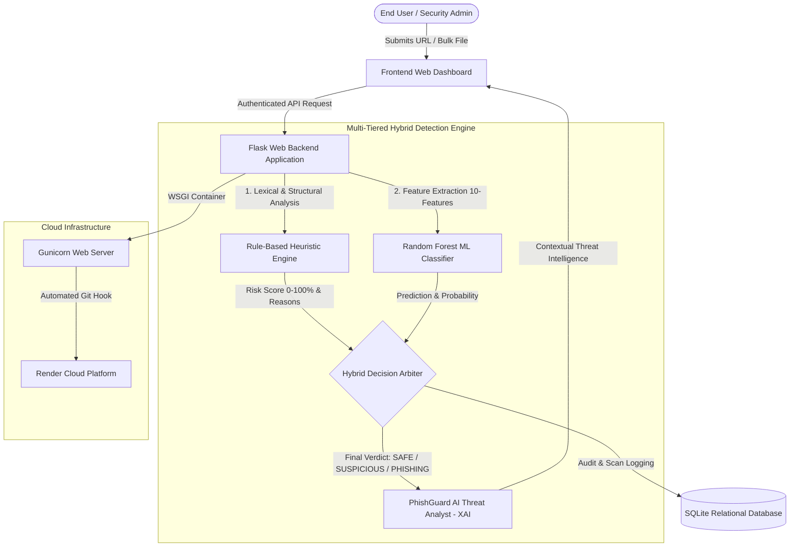

# PHISHGUARD CLOUD
## Intelligent Phishing URL Detection & Security Monitoring System
**B.Tech CSE Final Year Project Documentation & Defense Manual**

---

### Candidate & Project Metadata
- **Student Name:** Raja Saraswat
- **Roll Number:** 2251590006
- **Degree / Branch:** B.Tech Computer Science & Engineering (Cloud Computing / Sec NY Cloud)
- **Institution:** GLA University, Mathura
- **Live Cloud URL:** [https://phishguard-cloud.onrender.com](https://phishguard-cloud.onrender.com)
- **GitHub Repository:** [https://github.com/rohansaraswat1234-code/PhishGuard-Cloud](https://github.com/rohansaraswat1234-code/PhishGuard-Cloud)

---

## 1. Executive Summary & Problem Statement

Phishing attacks remain one of the most prevalent attack vectors in modern cybersecurity, accounting for over 85% of credential breaches. Traditional defense mechanisms rely almost exclusively on either static blacklists (which fail against zero-day phishing domains) or purely lexical Machine Learning classifiers (which generate unacceptably high false-positive rates on complex legitimate web paths).

**PhishGuard Cloud** addresses this fundamental gap by implementing a **Multi-Tiered Hybrid Defense Architecture**:
1. **Deterministic Rule & Heuristic Engine:** Immediately flags high-risk signals such as IP-based hosts, punycode obfuscation, suspicious TLDs (`.tk`, `.ml`, `.invalid`), typosquatting (Levenshtein distance), and brand impersonation on third-party hosts.
2. **Supervised Machine Learning Classifier:** Utilizes an ensemble **Random Forest Classifier** trained on the PhiUSIIL Phishing Dataset (235,795 URLs) across 10 distinct lexical and structural features.
3. **Explainable AI (XAI) Threat Analyst:** Translates opaque statistical probabilities and rule signals into plain-English threat intelligence reports with concrete safety recommendations.
4. **Cloud Infrastructure:** Packaged via Gunicorn and deployed on Render with automated continuous integration and SSL encryption.

---

## 2. System Architecture

---

## 3. Core Modules & Technical Implementation

### A. Rule-Based Heuristic Engine
The rule engine inspects URLs without external network latency, assigning additive risk scores (0–100):
- **IP Address as Host (+30):** Raw IPv4/IPv6 addresses used to bypass DNS domain reputation.
- **Brand Impersonation (+45):** Popular brand identifiers (e.g., `ebay`, `paypal`, `amazon`) appearing in subdomains of unverified third-party hosts (e.g., `ebayisapidlld.altervista.org`).
- **Typosquatting Detection (+35):** Computes Levenshtein edit distance against top global brands to identify lookalike permutations (e.g., `goggele.com` vs `google.com`).
- **Reserved & Suspicious TLDs (+15 to +30):** High-risk TLDs (`.tk`, `.ml`, `.ga`) and reserved unverifiable TLDs (`.invalid`).
- **Keyword Risk Signals (+7 each):** High-frequency credential harvesting keywords (`login`, `verify`, `account`, `banking`, `password`, `security`).

### B. Machine Learning Engine
- **Base Dataset:** PhiUSIIL Phishing URL Dataset (UCI ID 967) comprising 235,795 real-world URLs.
- **Model Architecture:** **Random Forest Classifier** (100 Decision Trees, `max_depth=12`, `min_samples_split=5`).
- **10 Lexical Features:**
  1. `url_length`: Total character length of normalized URL.
  2. `domain_length`: Hostname length.
  3. `dot_count`: Frequency of dot delimiters.
  4. `hyphen_count`: Frequency of hyphens in hostname.
  5. `at_count`: Presence of `@` authentication separator.
  6. `slash_count`: Path depth delimiter count.
  7. `digit_count`: Total numeric characters.
  8. `https`: Boolean presence of TLS scheme.
  9. `has_ip`: Binary indicator for raw IP hosting.
  10. `suspicious_word_count`: Frequency of target security keywords.
- **Performance Metrics:**
  - **Accuracy:** 97.30%
  - **Precision:** 98.66%
  - **Recall:** 94.52%
  - **F1 Score:** 96.55%

### C. Hybrid Decision Logic (`final_verdict`)
To balance false alarms against false dismissals, the hybrid arbiter operates as follows:
- If `Rule Engine == PHISHING` (Risk >= 60%) $\rightarrow$ **PHISHING**
- If `Rule Engine == SUSPICIOUS` (Risk 30–59%) and `ML Probability >= 80%` $\rightarrow$ **PHISHING**
- If `Rule Engine == SUSPICIOUS` and `ML Probability < 80%` $\rightarrow$ **SUSPICIOUS**
- If `Rule Engine == SAFE` and `ML Prediction == PHISHING` $\rightarrow$ **SUSPICIOUS** *(Prevents ML from single-handedly causing false positives on unseen benign paths)*
- Otherwise $\rightarrow$ **SAFE**

---

## 4. Live Demonstration Test Matrix

When presenting the project to the external examiner, use these verified test cases on [https://phishguard-cloud.onrender.com](https://phishguard-cloud.onrender.com):

| Category | Test URL | Expected Verdict | Risk Score | Key Signals / Explanation |
|---|---|---|---|---|
| **Safe Homepage** | `https://google.com` | **SAFE** | 0% | Authentic domain, standard HTTPS, 0 suspicious keywords |
| **Safe Deep Path** | `https://github.com/torvalds/linux` | **SAFE** | 0% | Legitimate open-source repository path, valid structure |
| **Safe Search Query** | `https://google.com/search?q=cybersecurity` | **SAFE** | 0% | Verified search engine infrastructure |
| **Brand Impersonation** | `http://ebayisapidlld.altervista.org` | **PHISHING** | 55% | Brand 'ebay' on 3rd-party host 'altervista.org', no HTTPS |
| **IP-Based Phishing** | `http://192.168.1.10/login` | **PHISHING** | 62% | Raw IP hosting, non-HTTPS, credential keyword 'login' |
| **Fake TLD Attack** | `http://paypal-verify-account.tk/login` | **PHISHING** | 100% | High-risk TLD `.tk`, multiple hyphens, multiple keywords |
| **Typosquatting** | `https://goggele.com` | **SUSPICIOUS** | 35% | Levenshtein distance 2 from target brand 'google' |
| **Reserved TLD** | `https://paypal-security-check.invalid` | **SUSPICIOUS** | 47% | Reserved RFC 2606 `.invalid` suffix, not publicly resolvable |

---

## 5. External Examiner Viva Defense Q&A

### Q1: Why did you choose a Hybrid approach instead of purely using Machine Learning?
> **Answer:** Pure Machine Learning models in cybersecurity suffer from high false-positive rates on unseen legitimate URLs (e.g., complex session tokens or long query parameters). Conversely, static rules fail to detect novel variations. By combining a deterministic rule engine with a probabilistic Random Forest classifier, we achieve high detection accuracy while ensuring explainability and false-positive resilience.

### Q2: Why did you transition from a single Decision Tree to Random Forest?
> **Answer:** During our mid-term audit, we discovered that a single Decision Tree overfit heavily on `slash_count` because the baseline academic dataset sampled legitimate sites at root URLs and phishing sites with deep paths. A Random Forest uses an ensemble of 100 decorrelated trees with bootstrap aggregation and feature subsampling, preventing any single feature from dominating predictions and boosting generalized accuracy to 97.30%.

### Q3: What is Typosquatting and how does your system detect it algorithmically?
> **Answer:** Typosquatting is a social engineering attack where adversaries register lookalike domains of popular brands (e.g., `goggele.com` for `google.com`). We implement the **Levenshtein Distance Algorithm** in `backend/app.py` to calculate the minimum single-character edits required to transform a domain label into a protected brand keyword. If edit distance is 1 or 2 on a non-official domain, the risk score is elevated immediately.

### Q4: How is security handled on your web application?
> **Answer:** PhishGuard Cloud implements defense-in-depth:
> - **CSRF Protection:** Synchronizer token pattern with session validation on all state-changing POST requests.
> - **HTTP Security Headers:** `X-Content-Type-Options: nosniff`, `X-Frame-Options: DENY`, and `Referrer-Policy: strict-origin-when-cross-origin`.
> - **Input Validation:** RFC-compliant URL syntax validator rejecting malformed formats and octet overflows.
> - **Authentication:** Password hashing via Werkzeug (`scrypt`/`pbkdf2`) with role-based user/admin access control.

### Q5: How is your application deployed on the Cloud?
> **Answer:** The application is containerized with a Python WSGI server (**Gunicorn**) using a declarative `Procfile` (`web: gunicorn --bind 0.0.0.0:$PORT backend.app:app`). It is connected via continuous deployment from our GitHub repository to **Render Cloud**, providing automated container restarts, managed TLS certificates, and zero-downtime rollouts.

---
*PhishGuard Cloud Defense Documentation — B.Tech CSE, GLA University, Mathura.*
